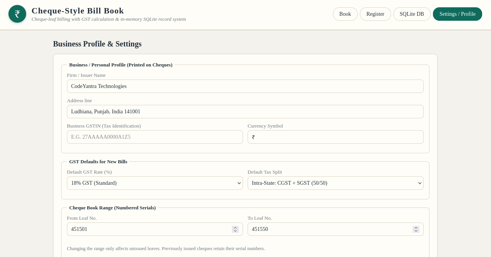
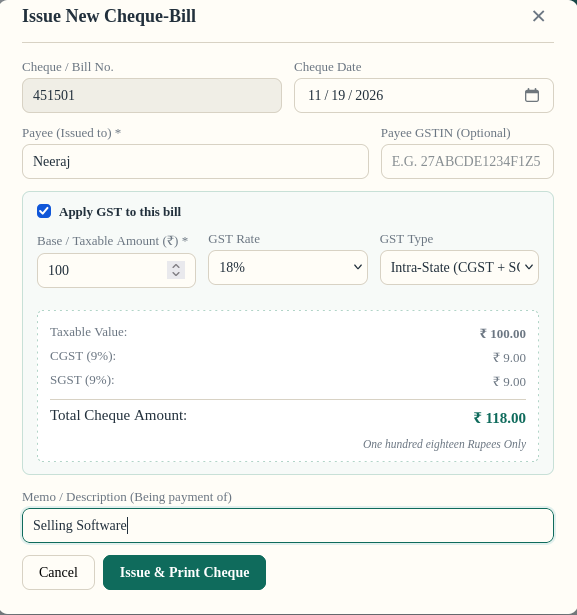

# Cheque-Style Bill Book

A browser-based billing application that combines a cheque-book interface with GST calculations, numbered bill records, and printable cheque-style layouts. Built with HTML, CSS, and JavaScript, with no frontend dependencies or build step.


## Features

- **Cheque-style bills:** Printable leaves with a counterfoil, boxed date, amount in words, signature area, and decorative MICR-style band.
- **GST calculations:** Optional GST with preset or custom rates, CGST + SGST for intra-state bills, and IGST for inter-state bills.
- **Business profile:** Configure the issuer name, address, GSTIN, currency symbol, logo, and legal footer.
- **Numbered bill book:** Set a serial range, issue bills sequentially, and track issued, paid, and void records.
- **Searchable register:** Find bills by payee, memo, number, or GSTIN; filter by status and GST applicability.
- **Payment details:** Record bill dates and payment due dates, and mark bills as paid or void.
- **Data tools:** Export JSON backups or SQL dumps, import saved data, and inspect records through the built-in SQL-style console.
- **Print support:** Print a bill through the browser or save it as a PDF using the browser's print dialog.

## Getting started

### Run the browser application

Clone the repository and start a local static server using Python 3:

```bash
git clone https://github.com/BuiltByNeeraj/Cheque-style-bill-book.git
cd Cheque-style-bill-book
python3 -m http.server 8080 --bind 127.0.0.1
```

Open [localhost:8080](http://localhost:8080) in a modern browser. No package installation is required.

You can also open `index.html` directly, although browser rules for local-file storage vary. Using a local server gives the application a consistent browser origin.

### Create your first bill

1. Open **Settings / Profile**, enter your business details, set the cheque number range and GST defaults, and save.
2. In **Book**, select **Issue New Cheque-Bill**.
3. Enter the payee, bill date, due date, amount, and any GST details.
4. Issue the bill, then open its leaf to preview or print it.
5. Use **Register** to search records and update payment status.
6. Export a backup from **Settings / Profile** before clearing browser data or moving to another device.

## Screenshots

### Business profile

Configure business details, tax defaults, and the numbered book range.



### Create a bill

Enter payee and payment details and review the GST calculation.



### Paid bill

The printable bill reflects its payment status.


The issued bill preview appears at the top of this README. All screenshots are stored in [`docs/screenshots/`](docs/screenshots/).

## Storage and database behavior

The browser application uses a custom JavaScript relational store in `sqlite-engine.js`. It keeps records in memory and saves business settings and bills to browser `localStorage`. The **SQLite DB** tab provides a limited SQL-style query interface; it does not run a native SQLite engine or support arbitrary SQLite statements.

Data belongs to the browser profile and origin where the application runs. Changing the hostname or port can show a different dataset. Clearing site storage removes saved records. Use JSON or SQL exports for backups and transfers; there is no automatic cloud synchronization.

### Optional Python SQLite server

To serve the application alongside a native SQLite API, run:

```bash
python3 server.py 8080
```

The server uses only Python's standard library and creates a SQLite database with `sqlite3.connect(":memory:")`. Its API includes settings, bills, SQL execution, and SQL export endpoints.

**The current frontend does not call these API endpoints.** Browser records and server records are separate, and the server database is lost when its process stops. The bundled server listens on all network interfaces and is intended for local development; it has no authentication.

## Project structure

```text
Cheque-style-bill-book/
├── index.html          # Application views, forms, and dialogs
├── styles.css          # Interface, cheque layout, and print styles
├── app.js              # Billing workflow, GST calculations, and rendering
├── sqlite-engine.js    # Browser data store, query support, and SQL import/export
├── server.py           # Optional HTTP server and in-memory SQLite API
├── docs/
│   └── screenshots/    # Application screenshots used in this README
└── README.md
```

## Technology

| Layer | Implementation |
| --- | --- |
| Interface | HTML5 and CSS3 |
| Application logic | Vanilla JavaScript |
| Browser persistence | Local storage |
| Optional backend | Python 3 standard library: `http.server` and `sqlite3` |
| Printing | Browser print dialog and print-specific CSS |

## Contributing

Open an issue to report a bug or suggest an improvement. For a pull request, describe the change, include screenshots for interface updates, and explain how you verified the affected workflow.
