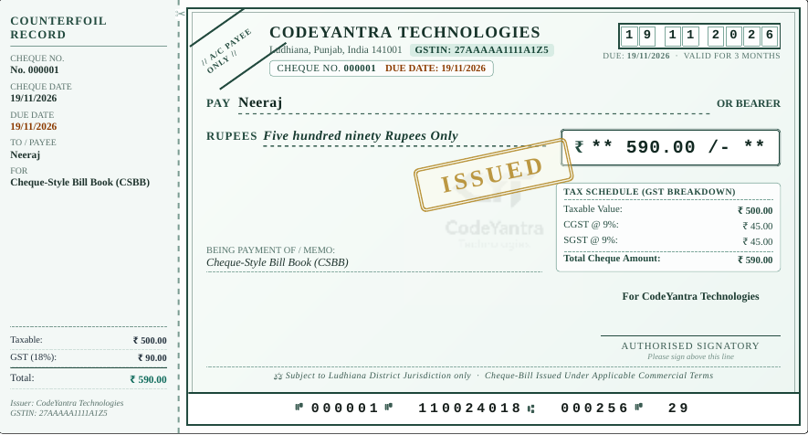
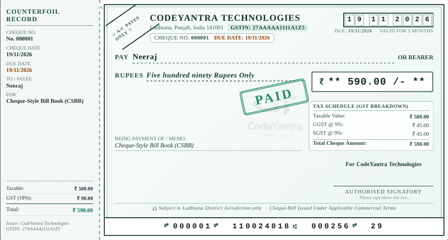

# Cheque-Style Bill Book

A browser-based billing application that combines a cheque-book interface with GST calculations, numbered bill records, and printable cheque-style layouts. Built with HTML, CSS, and JavaScript, with a Python + SQLite local backend, no runtime third-party dependencies, and no frontend build step. Linux is the current target platform.



## Features

- **Cheque-style bills:** Printable leaves with a counterfoil, boxed date, amount in words, signature area, and decorative MICR-style band.
- **GST calculations:** Optional GST with preset or custom rates, CGST + SGST for intra-state bills, and IGST for inter-state bills.
- **Business profile:** Configure the issuer name, address, GSTIN, currency symbol, logo, and legal footer.
- **Numbered bill book:** Set a serial range, issue bills sequentially, and track issued, paid, and void records.
- **Searchable register:** Find bills by payee, memo, number, or GSTIN; filter by status and GST applicability.
- **Payment details:** Record bill dates and payment due dates, and mark bills as paid or void.
- **Persistent local records:** SQLite stores settings and invoices outside the repository and browser profile.
- **Data tools:** Export JSON or SQL data, import without overwriting invoices, and create verified full SQLite backups with recovery-safe restore. The existing console inspects a read-only browser snapshot.
- **Print support:** Print a bill through the browser or save it as a PDF using the browser's print dialog.

## Getting started

### Run the browser application

Use Python 3 on Linux:

```bash
git clone https://github.com/BuiltByNeeraj/Cheque-style-bill-book.git
cd Cheque-style-bill-book
python3 server.py 8080
```

Open **[127.0.0.1:8080](http://127.0.0.1:8080)**. Keep the server running while using the app. Start it again after reboot; saved records remain on disk. No package installation is required.

The local Python backend is required; direct file opening and static hosting do not support saves. Use `127.0.0.1`, not `localhost`, because the server validates its exact Host and Origin.

For existing browser records, **export JSON from the old app at its original URL first**. Migration is explicit and never clears localStorage. See the [Linux migration, backup, restore, and acceptance guide](docs/linux-local-storage.md).

### Create your first bill

1. Open **Settings / Profile**, enter your business details, set the cheque number range and GST defaults, and save.
2. In **Book**, select **Issue New Cheque-Bill**.
3. Enter the payee, bill date, due date, amount, and any GST details.
4. Issue the bill, then open its leaf to preview or print it.
5. Use **Register** to search records and update payment status.
6. Export a backup from **Settings / Profile** before clearing browser data or moving to another device.

## Screenshots

### Business profile

Configure business details, tax defaults, and the numbered book range.


### Create a bill

Enter payee and payment details and review the GST calculation.


### Paid bill

The printable bill reflects its payment status.



The issued bill preview appears at the top of this README. All screenshots are stored in [`docs/screenshots/`](docs/screenshots/).

## Storage and database behavior

The backend uses Python's standard `sqlite3` module and stores the database at:

```text
${XDG_DATA_HOME:-$HOME/.local/share}/cheque-style-bill-book/billbook.sqlite3
```

Invoice numbering and inserts are committed together. Duplicate and voided numbers cannot be overwritten. Imports are atomic and reject conflicts. GST calculations and the cheque template retain their existing behavior and layout.

Browser localStorage is used only as an explicitly approved migration source. It is never modified by the new application. JSON exports remain available; full SQLite backup/restore commands verify integrity and preserve a recovery backup before restoration. Read the [operations guide](docs/linux-local-storage.md) before migrating or restoring customer data.

The server listens only on `127.0.0.1`, validates Host and Origin, requires CSRF protection on writes, and exposes no SQL execution API. The SQLite DB console queries the loaded browser snapshot only.

## Project structure

```text
Cheque-style-bill-book/
├── index.html          # Application views, forms, and dialogs
├── styles.css          # Interface, cheque layout, and print styles
├── app.js              # Billing workflow, GST calculations, and rendering
├── sqlite-engine.js    # Backend adapter, snapshot query support, and SQL export
├── server.py           # Protected loopback HTTP server and operations CLI
├── storage.py          # Transactional SQLite persistence, import, backup, restore
├── tests/              # Persistence, security, frontend, GST, and browser tests
├── docs/
│   ├── screenshots/    # Application screenshots used in this README
│   └── linux-local-storage.md # Migration, operations, and acceptance guide
└── README.md
```

## Technology

| Layer | Implementation |
| --- | --- |
| Interface | HTML5 and CSS3 |
| Application logic | Vanilla JavaScript |
| Persistence | File-backed SQLite in the Linux application data directory |
| Local backend | Python 3 standard library: `http.server` and `sqlite3` |
| Printing | Browser print dialog and print-specific CSS |

## Verification

```bash
PYTHONDONTWRITEBYTECODE=1 python3 -m unittest discover -s tests -v
node tests/frontend.test.js
```

Node.js is needed only for frontend tests. Optional Chromium integration checks and manual acceptance steps are documented in the [Linux guide](docs/linux-local-storage.md).

## Contributing

Open an issue to report a bug or suggest an improvement. For a pull request, describe the change, include screenshots for interface updates, and explain how you verified the affected workflow.
